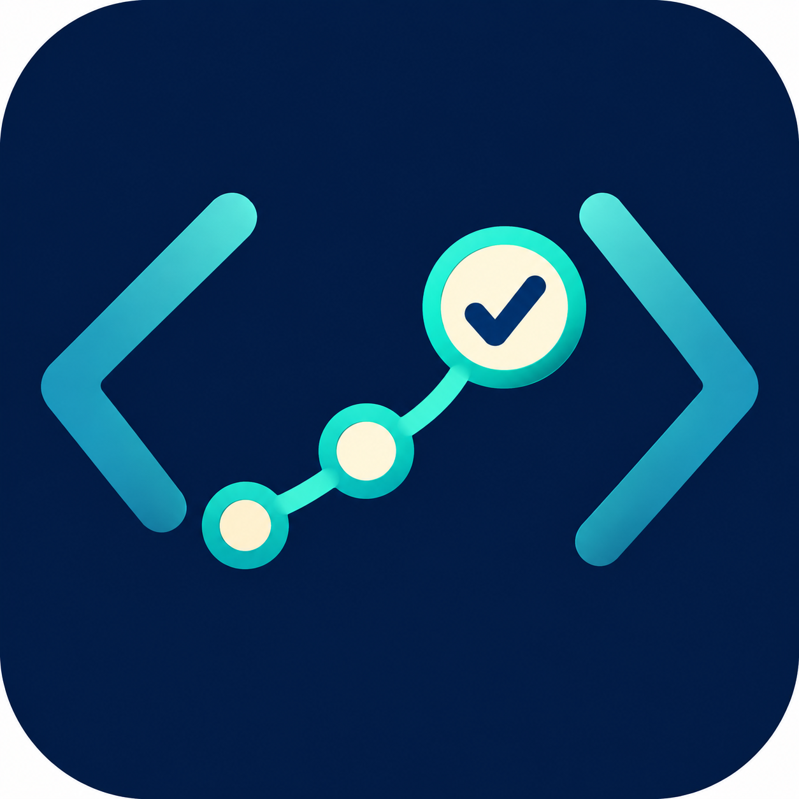

# Interview Prep Coach

An adaptive software engineering interview-prep course by Tyree Richardson. Build the ability to solve unfamiliar problems, explain your reasoning, and retrieve concepts later—not just recognize solutions.

<p align="center"></p>

## What it does

- Starts with a course overview and a targeted baseline; experienced learners need not restart at Module 1.
- Supports any programming language, with optional language, backend/database, system design, and behavioral tracks.
- Uses progressive hints and reviews your exact code before offering a replacement.
- Tracks proficiency separately from assisted practice and immediate interview readiness.
- Schedules delayed cold retrieval and adapts practice to observed weaknesses.
- Temporarily prioritizes employer-supplied topics when an interview is imminent.

| Status | Meaning |
| --- | --- |
| ⚪ | Not assessed |
| 🔴 | Demonstrated weakness |
| 🟡 | Assisted or inconsistent |
| 🟢 | Independently reliable on a cold attempt |

Understanding an explanation or repeating a just-taught solution does not establish green proficiency.

## Install the standalone Codex skill

This is the simplest installation for a local Codex environment with filesystem access.

1. Download the release ZIP, or clone this repository.
2. Copy the `skills/interview-prep` folder to `$CODEX_HOME/skills/interview-prep`, or `~/.codex/skills/interview-prep` if `CODEX_HOME` is unset.
3. Start a new Codex chat and invoke `$interview-prep`.

If you already have this skill, back up your progress and session logs before replacing anything. Update instructions and templates selectively; do not overwrite your learning state. Personal history is not included in this repository.

## Use as a plugin

The root `plugin.json` packages the same skill as `interview-prep-plugin`. For hosts that support local Agent Plugins, use their documented local plugin/marketplace installation flow. Downloading a ZIP alone does not install a plugin, and import options differ by host and account.

See [OpenAI plugin packaging and local installation documentation](https://developers.openai.com/plugins/build/plugins). This repository does not imply approval or listing in the OpenAI directory.

## Start a session

```text
Use $interview-prep. Let's begin the next day.
```

```text
Use $interview-prep. Start my course and ask about my language, notes, and goals.
```

```text
Use $interview-prep. Continue from my last session.
```

You can also ask to show the roadmap, review progress, switch language, give a hint, pause, or end a session.

## Learning state and privacy

On first use the coach creates `progress.md` from `progress-template.md`. Substantive sessions are logged in `sessions/YYYY-MM-DD.md`; `topic-map.md` supplies the initial generic curriculum. State defaults to the installed skill folder, so filesystem write access is needed for persistent tracking. Keep a backup outside plugin caches before reinstalling/updating. A learner-selected notes location can be configured explicitly.

The package contains instructions and an icon; it runs no service and adds no API endpoint or telemetry. Your AI host processes conversations under its own terms. Code execution, web lookup, or an explicitly selected notes integration may use that host's available tools and permissions. Avoid putting confidential interview or employer material in public issues.

The gitignore excludes generated progress and dated session files, but inspect any changes to the topic map before pushing: it can acquire learner-specific context during use. Ignoring files does not remove already committed history.

## Feedback and limitations

Use GitHub Issues for bugs and suggestions. Include the behavior you expected and a short redacted example. Do not include personal session logs or credentials.

Development levels are coaching assessments, not hiring predictions. Persistent state needs a filesystem-capable host. The public package has been checked for structure, included assets, and accidental personal history; end-to-end installation and coaching behavior still need beta testing in each target host.

## License

[MIT](LICENSE). Copyright 2026 Tyree Richardson.
